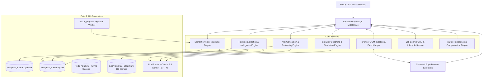
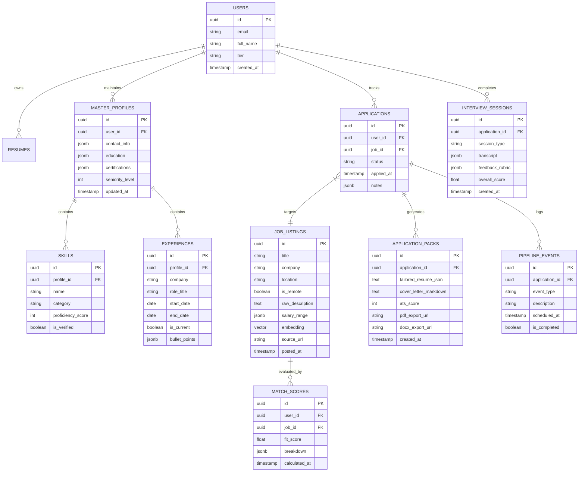
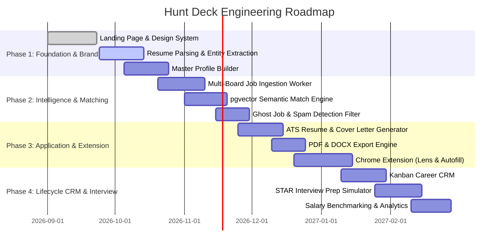

# Product Requirements Document (PRD): Hunt Deck
**The AI-Native Career Intelligence & Application Operating System**

---

| **Document Metadata** | **Specification** |
| :--- | :--- |
| **Product Name** | **Hunt Deck** |
| **Document Version** | `2.0.0-DEFINITIVE-SPEC` |
| **Status** | Approved for Engineering Architecture & Sprint Planning |
| **Target Platforms** | Web Application (Desktop-First, Responsive Mobile), Chrome / Edge Browser Extension, PWA Companion |
| **Primary Architecture** | Next.js 15 (App Router, Server Actions, React Server Components), TypeScript, Tailwind CSS, PostgreSQL 16 + `pgvector`, Redis (BullMQ queues), Python / FastAPI AI Ingestion Microservice |
| **AI / LLM Orchestration** | Hybrid Routing: Claude 3.5 Sonnet (complex semantic reasoning & nuanced editorial generation), GPT-4o / GPT-4o-mini (fast structured entity extraction), `text-embedding-3-large` (dense vector embeddings) |
| **Design Language** | Editorial Restraint / Institutional SaaS (`Inter` + `Instrument Serif`, Deep Navy `#16213A`, Warm Cream `#FAF7F0`, Muted Slate `#5B6478`, Accent Navy `#2D5F8A`) |
| **Primary Tagline** | *"Land interviews, not rejection emails."* |

---

## 1. Executive Summary & Product Vision

### 1.1 The Vision
Hunt Deck transforms the modern job search from an emotionally exhausting, chaotic numbers game into a precision-engineered, intelligence-driven campaign. By unifying deep resume parsing, semantic job discovery, ATS-tailored application pack generation, browser-native 1-click autofill, real-time interview coaching, and lifecycle pipeline CRM into a single cohesive platform, Hunt Deck eliminates the friction, generic spray-and-pray rejection loop, and administrative burnout that plagues modern professionals.

### 1.2 Core Product Philosophy & Non-Negotiables
1. **Quality & Signal Over Bot Spam**: Hunt Deck vehemently rejects "mass spam 500 bots" that ruin candidate reputations and clutter recruiter inboxes. Every application produced through Hunt Deck is bespoke, high-signal, verified, and tuned to the exact requirements of the hiring team.
2. **Deterministic Truth & Zero Hallucination**: The AI reframes, spotlights, and translates a candidate's *real* verified accomplishments, skills, and metrics to match a Job Description (JD); it **never fabricates** credentials, employers, degrees, or quantitative results.
3. **End-to-End Continuum**: Job seeking does not end when an application is submitted. Hunt Deck bridges the chasm between application generation and interview performance, preparing the candidate with role-specific case studies, behavioral STAR prompts, and real-time interactive critique.
4. **Institutional Elegance & User Dignity**: Job hunting is high-stakes and emotionally vulnerable. Hunt Deck rejects flashy, gamified "purple glow AI" tropes in favor of an authoritative, calm, executive workspace that inspires focus and composure.
5. **Data Sovereignty & Enterprise Privacy**: User resumes, application letters, and interview recordings are strictly confidential. User data is never used to train public foundation models.

---

## 2. Problem Statement & Market Opportunity

### 2.1 The Crisis in the Modern Hiring Landscape
* **The "Rejection Email & Ghost Job" Epidemic**: Job seekers submit hundreds of resumes on LinkedIn and Indeed into applicant tracking systems (ATS) like Workday, Taleo, Greenhouse, and Lever, receiving automated rejections or radio silence due to keyword mismatch, formatting glitches, and stale job postings.
* **The Fragmented DIY Workflow**: Candidates currently juggle a patchwork of disconnected tools: Google Sheets or Notion for tracking, ChatGPT or Claude for generic cover letters, Jobscan or Teal for basic keyword counts, and LinkedIn for discovery. Context is fractured, and repetitive manual copy-pasting wastes hundreds of hours.
* **The Failure of Generic AI**: Standard ChatGPT prompts produce robotic, cliché-ridden cover letters (*"I am writing to express my enthusiastic interest..."*) and hallucinated resume points that fail ATS parsers and alienate experienced hiring managers.
* **The Interview Conversion Gap**: Landing an interview is only half the battle. Candidates often face unexpected question formats, company-specific culture frameworks (e.g., Amazon Leadership Principles), and complex technical case studies without structured rehearsal.

### 2.2 Competitive Differentiation Matrix

| Capability | **Hunt Deck** | **DIY Spreadsheets + Word** | **Generic AI (ChatGPT / Claude)** | **Jobscan / Teal** |
| :--- | :---: | :---: | :---: | :---: |
| **Deep Resume Entity & Skill Extraction** | **Native & Instant (OCR + Multi-page)** | Manual (Hours) | Partial (Prompt dependent) | Yes (Basic keyword) |
| **Semantic Role Fit Scoring (vs Live Feed)** | **Automated (95%+ match via vectors)** | None | None (Static) | Basic Keyword Matching |
| **ATS-Engineered Resume Rewrites** | **Bespoke per Job (Google XYZ formula)** | Manual | Hallucinates formatting & data | Suggests edits only |
| **Impact-Quantified Bullet Reframing** | **Integrated AI Engine with Guardrails** | Manual | Often generic/exaggerated | Limited |
| **Tailored Cover Letter Synthesis** | **Matched to JD, Company & Voice** | Manual | Cliché / Bot-like | Template fills |
| **Browser Extension 1-Click Autofill** | **Direct DOM Injection for ATS Portals** | None | None | Limited form-fill |
| **Role-Specific AI Interview Simulation** | **Native (JD + Company Specific Mock)** | None | Requires manual prompt setup | None |
| **Application Pipeline CRM & Stage Tracking** | **Unified Kanban Board with Metrics** | Manual Maintenance | None | Basic list |
| **Zero Data Training Guarantee** | **Guaranteed (Enterprise Grade)** | N/A | Depends on privacy settings | Variable |

---

## 3. Target User Personas & Journey Maps

```
┌──────────────────────────────────────────────────────────────────────────────────────────────────┐
│                                   HUNT DECK END-TO-END JOURNEY                                   │
└──────────────────────────────────────────────────────────────────────────────────────────────────┘
     │
     ▼
[ 1. Ingest & Audit ]   ──► Upload Resume (PDF/DOCX) ──► Semantic Skill, Trajectory & Level Extraction
     │
     ▼
[ 2. Discover & Match ] ──► Ingest Direct Feeds ──► Vector Embedding Fit Scoring (Filter Ghost Jobs)
     │
     ▼
[ 3. Tailor & Perfect ] ──► Select Target Role ──► Generate ATS Application Pack (Resume + Cover Letter)
     │
     ▼
[ 4. 1-Click Apply ]    ──► Chrome Extension Autofill on Workday/Greenhouse/Lever ──► Auto-log to CRM
     │
     ▼
[ 5. Manage & Track ]   ──► Unified Kanban Pipeline ──► Follow-up Reminders, Calendar Sync, Analytics
     │
     ▼
[ 6. Interview Prep ]   ──► Role & Company Mock Simulator ──► Audio/Text STAR Feedback ──► Signed Offer
```

### 3.1 Primary Personas

#### Persona 1: Elena Rostova — The Early Career Graduate
* **Profile**: Recent Master's graduate in Human-Computer Interaction / Business Analytics.
* **Pain Point**: Struggles with the "need 3–5 years experience for an entry-level job" paradox. Her resume fails keyword filters because academic research and internship projects aren't phrased in commercial impact vocabulary.
* **Hunt Deck Value**: Parser extracts core methodologies, reframing coursework into ATS-compliant commercial accomplishments using the Google XYZ formula, matching her to roles seeking high-trajectory juniors.

#### Persona 2: Marcus Vance — The Mid-Career Switcher
* **Profile**: 8 years in Management Consulting transitioning to Tech Product Management.
* **Pain Point**: Resumes are packed with consulting jargon that tech recruiters discard in 6 seconds. Manually tailoring a 2-page resume for 50 different tech job specs takes over 100 hours.
* **Hunt Deck Value**: Tailoring engine maps consulting frameworks (stakeholder governance, quantitative modeling) directly into agile product delivery vocabulary and user growth metrics.

#### Persona 3: Sarah Jenkins — The Senior Remote Specialist
* **Profile**: Staff Distributed Systems Engineer seeking high-compensation remote roles.
* **Pain Point**: Sifting through thousands of "remote" listings that mandate US citizenship, specific state residency, or hide low-ball compensation bands.
* **Hunt Deck Value**: High-precision remote compliance filters, verified compensation benchmarks, and semantic matching against top-tier tech engineering specs.

---

## 4. System Architecture & High-Level Topology



---

## 5. Detailed Functional Module Requirements

---

### Module 1: Resume Ingestion, Extraction & Master Profile Intelligence

#### 1.1 Purpose
Ingests raw, unstructured resumes in any standard format, extracts structured career data, computes an authoritative baseline profile, and establishes the candidate's verified Golden Record.

#### 1.2 Functional Specifications
1. **File Ingestion & Parsing**:
   - Supports `.pdf`, `.docx`, `.txt`, and `.rtf` files up to 20MB.
   - Dual-layer extraction: Direct text stream parsing (`pdf-parse`, `mammoth.js`) + OCR engine fallback (Tesseract / AWS Textract) for scanned or flattened PDFs.
   - Fault-tolerant multi-column and layout-aware segmentation (bounding box layout analysis).
2. **Entity & Trajectory Extraction**:
   - **Personal & Contact Info**: Full Name, Email, Phone, Location (City, State/Country, Remote Preference), LinkedIn, GitHub, Portfolio URL.
   - **Work Experience Graph**: Company name, standard job title, employment duration (start/end dates, present flag), calculated tenure, work arrangement (on-site, hybrid, remote).
   - **Achievement Atomization**: Splits dense responsibility paragraphs into discrete, measurable achievement atoms.
   - **Quantified Metric Detection**: Tags numerical metrics (e.g., "$3.2M ARR", "45% reduction in latency", "managed team of 14").
   - **Skills Taxonomy & Proficiency**: Maps free-form text against an ontology of 12,000+ standardized skills (categorized into Languages, Frameworks, Cloud/Infra, Methodologies, Tools, Domain Expertise).
   - **Seniority & Trajectory Classification**: Automatically assesses career progression (Junior, Mid, Senior, Lead, Staff/Principal, Manager, Director, VP, C-Suite).
3. **Master Profile (The Golden Record)**:
   - Central repository storing every project, credential, patent, publication, and metric the user has ever accomplished.
   - Provides a frictionless inline editing UI allowing users to add unlisted achievements, adjust proficiency sliders, and curate custom tags.
   - Strict versioning history: Every edit is saved with rollback support.

---

### Module 2: Live Job Aggregation & Semantic Vector Matching Engine

#### 2.1 Purpose
Continuously aggregates live opportunities from verified direct company career portals and top job boards, purges ghost listings and recruiter spam, and scores each role against the candidate's Master Profile using dense vector embeddings.

#### 2.2 Functional Specifications
1. **Multi-Source Job Aggregator**:
   - Ingests opportunities from Greenhouse, Lever, Workday, Ashby, BambooHR, LinkedIn, Indeed, and direct company careers pages.
   - Normalizes salary ranges, minimum experience requirements, remote eligibility, and visa sponsorship status.
2. **Anti-Spam & "Ghost Job" Detection Filter**:
   - Flags or suppresses:
     * Duplicate postings across boards.
     * Stale listings open for >60 days without verified hiring activity or recruiter updates.
     * Third-party staffing agency bait-and-switch listings.
     * Postings missing verifiable company domain or corporate registration.
3. **Multi-Dimensional Semantic Match Scoring Algorithm**:
   - Calculates a normalized **Fit Score (0–100%)**:
     * **Semantic Experience Match (40%)**: Cosine similarity between job description embeddings and candidate Master Profile embeddings using `text-embedding-3-large`.
     * **Hard Skills Match (30%)**: Verification of mandatory technical proficiencies, frameworks, and required certifications.
     * **Seniority & Leadership Scope (20%)**: Alignment between role prerequisites and candidate historical scope.
     * **Logistics & Compensation Match (10%)**: Remote compatibility, timezone overlap, and salary expectation overlap.
4. **Candidate Matching Feed UI**:
   - Instant sorting: Fit Score, Date Posted, Salary High-to-Low, Remote Only.
   - **Inspect Match Breakdown Modal**: Displays exact overlapping skills, highlighted missing keywords, and specific areas where the candidate exceeds expectations.

---

### Module 3: ATS-Optimized Application Pack Generator

#### 3.1 Purpose
Generates a bespoke, job-specific application pack for any target role in under 60 seconds, consisting of an ATS-compliant tailored resume, a personalized cover letter, and an ATS pre-flight audit report.

#### 3.2 Functional Specifications
1. **Tailored Resume Synthesis**:
   - Analyzes target Job Description for primary keyword density, ATS scoring criteria, and role emphasis.
   - Re-orders, re-phrases, and emphasizes candidate experiences from the Master Profile to spotlight relevant accomplishments.
   - Enforces the **Google XYZ Formula**: *"Accomplished [X] as measured by [Y], by doing [Z]"*.
   - **Anti-Hallucination Guardrails**: Strictly forbids inventing employers, dates, degrees, or skills not present in the Master Profile.
2. **ATS Compliance & Layout Engine**:
   - Generates clean, single-column or ATS-validated two-column layouts.
   - Pure typography and standard font hierarchies; avoids complex nested tables, text boxes, non-standard symbols, or embedded graphics that crash ATS scanners.
   - Formats exportable as machine-readable `.pdf` (with searchable text layer) and fully editable `.docx`.
3. **Bespoke Cover Letter Generator**:
   - Synthesizes the candidate's background with company mission, recent news, and specific JD challenges.
   - Avoids cliché openers (*"I am writing to express my enthusiastic interest in..."*). Uses confident, conversational, value-first openings.
   - Tone controls: Executive / Direct, Warm / Collaborative, Modern Tech / Casual.
4. **Live ATS Pre-Flight Audit Report**:
   - Calculates **Keyword Density Match** (e.g., 94/100).
   - Identifies missing critical skills or certifications required by the JD.
   - Verifies contact information formatting, date syntax, and header hierarchy.

---

### Module 4: Browser Extension (Hunt Deck Lens & Autofill Companion)

#### 4.1 Purpose
A lightweight Chrome / Edge extension that brings Hunt Deck intelligence directly into the user's browser, allowing one-click job bookmarking, live match score overlays on LinkedIn/Indeed, and 1-click autofill on external ATS portals.

#### 4.2 Functional Specifications
1. **Instant Job Capture**:
   - Automatically detects job listings on LinkedIn, Indeed, Glassdoor, Wellfound, Greenhouse, Lever, and Workday.
   - Extracts job title, company name, location, salary, and full description with 1 click; syncs directly to the user's Hunt Deck CRM.
2. **On-Page Match Score Badge**:
   - Injects a discrete Hunt Deck badge onto job listings, displaying the real-time Fit Score (e.g., "94% Match") before the user clicks into the posting.
3. **1-Click ATS Application Autofill**:
   - Detects form fields on complex multi-step application portals (Workday, Taleo, Greenhouse, Lever, Ashby).
   - Automatically maps and populates:
     * Personal details, addresses, phone, URLs.
     * Employment history, dates, titles, and tailored bullet points.
     * Education and degree details.
     * Standard EEOC / demographic survey questions (with user consent).
   - Uploads the specific tailored resume PDF generated for that role directly into the file upload field.

---

### Module 5: Role-Specific Interview Preparation Copilot

#### 5.1 Purpose
Equips candidates to convert interviews into signed offers by simulating realistic interview sessions based on the exact job description, company culture, and candidate background.

#### 5.2 Functional Specifications
1. **Company & Role Question Generation**:
   - Generates 15–20 high-probability interview questions split across:
     * **Technical & Domain Expertise**: Deep dives into candidate's listed skills and case studies.
     * **Behavioral & Culture Fit**: Situation handling based on company leadership principles (e.g., Amazon Leadership Principles, Stripe Operating Principles).
     * **Reverse Interviewing**: Strategic, high-signal questions for the candidate to ask the interviewer.
2. **STAR Framework Response Builder**:
   - Guides the candidate through structuring answers: **Situation &rarr; Task &rarr; Action &rarr; Result**.
   - Identifies candidate experiences from their resume that best address each question.
3. **Interactive AI Mock Interviewer**:
   - Voice or text-based conversational simulation.
   - Evaluates candidate answers on clarity, brevity, technical accuracy, and metric quantification.
   - Provides instant coaching hints: *"You explained the situation well, but didn't state your specific individual contribution or the quantifiable outcome."*

---

### Module 6: Application Pipeline CRM & Lifecycle Tracker

#### 6.1 Purpose
A unified career CRM that organizes every lead, active application, interview stage, and offer into a frictionless Kanban pipeline.

#### 6.2 Functional Specifications
1. **Pipeline Kanban Stages**:
   - **Saved / Wishlist** &rarr; **Applied** &rarr; **Recruiter Screen** &rarr; **Technical / Case** &rarr; **Onsite / Final** &rarr; **Offer Received** &rarr; **Archived / Rejected**.
2. **Application Pack Association**:
   - Every Kanban card links directly to the specific tailored resume and cover letter generated for that application.
3. **Timeline & Follow-Up Automation**:
   - Automatic reminder scheduling (e.g., *"Follow up with Stripe recruiter in 5 business days"*).
   - Interview calendar synchronization (Google Calendar / Outlook `.ics` export).
4. **Compensation & Offer Comparison Matrix**:
   - Side-by-side comparison of base salary, equity (RSU/options vesting schedule), bonus, health benefits, and remote stipends.

---

### Module 7: Career Intelligence & Salary Benchmarking Engine

#### 7.1 Purpose
Provides macroeconomic visibility into hiring trends, verified market compensation bands, and personal search performance analytics to empower confident salary negotiations.

#### 7.2 Functional Specifications
1. **Real-Time Salary Benchmarks**:
   - Aggregates verified compensation data normalized by role level, years of experience, geographic market, and remote tier.
   - Visualizes 25th, 50th, 75th, and 90th percentile compensation curves.
2. **Equity Valuation & Vesting Calculator**:
   - Models total compensation across 4-year horizons for both public company RSUs and private startup stock options (including strike price, 409A valuation, and dilution scenarios).
3. **Candidate Funnel Analytics**:
   - Displays key conversion metrics: Applications Submitted &rarr; Screening Rate &rarr; Onsite Rate &rarr; Offer Rate.
   - Flags bottlenecks (e.g., *"Your resume is converting at 18%, but drop-off occurs at the technical interview stage"*).

---

### Module 8: Enterprise, Coach & University Edition

#### 8.1 Purpose
Allows university career centers, outplacement agencies, and executive career coaches to manage candidate cohorts, review applications, and audit placement outcomes.

#### 8.2 Functional Specifications
1. **Cohort Dashboard**:
   - Overview of student / client search activity, pipeline progress, and interview milestones.
2. **Collaborative Review & Feedback**:
   - Coaches can review and annotate generated resumes, leave inline comments, and assign target roles to clients.
3. **Aggregate Placement Reporting**:
   - Institutional metrics on time-to-offer, average starting compensation, and top hiring industries.

---

## 6. Data Architecture & Database Schema

### 6.1 Entity Relationship Diagram



### 6.2 PostgreSQL 16 & pgvector DDL Specification

```sql
-- Enable necessary extensions
CREATE EXTENSION IF NOT EXISTS "uuid-ossp";
CREATE EXTENSION IF NOT EXISTS "vector";

-- 1. Users Table
CREATE TABLE users (
    id UUID PRIMARY KEY DEFAULT uuid_generate_v4(),
    email VARCHAR(255) UNIQUE NOT NULL,
    full_name VARCHAR(255) NOT NULL,
    avatar_url TEXT,
    tier VARCHAR(50) DEFAULT 'free' CHECK (tier IN ('free', 'pro', 'executive', 'enterprise')),
    stripe_customer_id VARCHAR(100),
    created_at TIMESTAMP WITH TIME ZONE DEFAULT CURRENT_TIMESTAMP,
    updated_at TIMESTAMP WITH TIME ZONE DEFAULT CURRENT_TIMESTAMP
);

-- 2. Master Profile Table
CREATE TABLE master_profiles (
    id UUID PRIMARY KEY DEFAULT uuid_generate_v4(),
    user_id UUID REFERENCES users(id) ON DELETE CASCADE,
    headline VARCHAR(255),
    summary TEXT,
    contact_info JSONB NOT NULL DEFAULT '{}'::jsonb,
    seniority_level INT DEFAULT 1,
    profile_embedding vector(1536),
    created_at TIMESTAMP WITH TIME ZONE DEFAULT CURRENT_TIMESTAMP,
    updated_at TIMESTAMP WITH TIME ZONE DEFAULT CURRENT_TIMESTAMP
);

-- 3. Experiences Table
CREATE TABLE experiences (
    id UUID PRIMARY KEY DEFAULT uuid_generate_v4(),
    profile_id UUID REFERENCES master_profiles(id) ON DELETE CASCADE,
    company VARCHAR(255) NOT NULL,
    role_title VARCHAR(255) NOT NULL,
    location VARCHAR(255),
    start_date DATE NOT NULL,
    end_date DATE,
    is_current BOOLEAN DEFAULT FALSE,
    bullet_points JSONB NOT NULL DEFAULT '[]'::jsonb,
    created_at TIMESTAMP WITH TIME ZONE DEFAULT CURRENT_TIMESTAMP
);

-- 4. Skills Table
CREATE TABLE skills (
    id UUID PRIMARY KEY DEFAULT uuid_generate_v4(),
    profile_id UUID REFERENCES master_profiles(id) ON DELETE CASCADE,
    name VARCHAR(100) NOT NULL,
    category VARCHAR(100),
    proficiency INT CHECK (proficiency BETWEEN 1 AND 5),
    is_verified BOOLEAN DEFAULT FALSE
);

-- 5. Job Listings Table (with pgvector embedding)
CREATE TABLE job_listings (
    id UUID PRIMARY KEY DEFAULT uuid_generate_v4(),
    title VARCHAR(255) NOT NULL,
    company VARCHAR(255) NOT NULL,
    location VARCHAR(255),
    is_remote BOOLEAN DEFAULT FALSE,
    raw_description TEXT NOT NULL,
    salary_min NUMERIC(12, 2),
    salary_max NUMERIC(12, 2),
    salary_currency VARCHAR(10) DEFAULT 'USD',
    source_url TEXT UNIQUE NOT NULL,
    source_portal VARCHAR(100),
    embedding vector(1536),
    is_ghost_flagged BOOLEAN DEFAULT FALSE,
    posted_at TIMESTAMP WITH TIME ZONE,
    created_at TIMESTAMP WITH TIME ZONE DEFAULT CURRENT_TIMESTAMP
);

-- Fast vector indexing using HNSW for cosine distance
CREATE INDEX job_listings_embedding_idx ON job_listings USING hnsw (embedding vector_cosine_ops);

-- 6. Applications Table
CREATE TABLE applications (
    id UUID PRIMARY KEY DEFAULT uuid_generate_v4(),
    user_id UUID REFERENCES users(id) ON DELETE CASCADE,
    job_id UUID REFERENCES job_listings(id) ON DELETE RESTRICT,
    stage VARCHAR(50) DEFAULT 'wishlist' CHECK (stage IN ('wishlist', 'applied', 'screening', 'technical', 'onsite', 'offer', 'rejected', 'archived')),
    applied_at TIMESTAMP WITH TIME ZONE,
    target_salary NUMERIC(12, 2),
    notes TEXT,
    created_at TIMESTAMP WITH TIME ZONE DEFAULT CURRENT_TIMESTAMP,
    updated_at TIMESTAMP WITH TIME ZONE DEFAULT CURRENT_TIMESTAMP
);

-- 7. Application Packs Table
CREATE TABLE application_packs (
    id UUID PRIMARY KEY DEFAULT uuid_generate_v4(),
    application_id UUID REFERENCES applications(id) ON DELETE CASCADE,
    tailored_resume JSONB NOT NULL,
    cover_letter_markdown TEXT NOT NULL,
    ats_score INT CHECK (ats_score BETWEEN 0 AND 100),
    ats_audit_report JSONB NOT NULL DEFAULT '{}'::jsonb,
    pdf_url TEXT,
    docx_url TEXT,
    created_at TIMESTAMP WITH TIME ZONE DEFAULT CURRENT_TIMESTAMP
);

-- 8. Interview Sessions Table
CREATE TABLE interview_sessions (
    id UUID PRIMARY KEY DEFAULT uuid_generate_v4(),
    application_id UUID REFERENCES applications(id) ON DELETE CASCADE,
    session_type VARCHAR(50) CHECK (session_type IN ('technical', 'behavioral', 'culture', 'reverse')),
    transcript JSONB NOT NULL DEFAULT '[]'::jsonb,
    feedback JSONB NOT NULL DEFAULT '{}'::jsonb,
    overall_score NUMERIC(3, 1),
    created_at TIMESTAMP WITH TIME ZONE DEFAULT CURRENT_TIMESTAMP
);
```

---

## 7. API Specification (Core Endpoints)

### 7.1 Resume & Profile Endpoints
* `POST /api/v1/resumes/parse`: Ingests multipart file (PDF/DOCX). Runs text extraction and LLM entity extraction. Returns structured profile JSON.
* `GET /api/v1/profile/master`: Retrieves the user's Golden Record profile.
* `PUT /api/v1/profile/master`: Updates achievements, skills, contact info, or recomputes vector embeddings.

### 7.2 Semantic Match Endpoints
* `POST /api/v1/jobs/match-feed`: Query parameters: `page`, `limit`, `remoteOnly`, `minFitScore`. Computes vector cosine similarity against user's profile embedding and returns ranked listings with detailed match breakdowns.
* `POST /api/v1/jobs/analyze-fit`: Accepts custom job description text or URL. Returns real-time Fit Score, missing keywords, and match audit report.

### 7.3 Application Pack Endpoints
* `POST /api/v1/applications/tailor`: Body: `{ applicationId, tonePreference, emphasisAreas }`. Invokes streaming LLM pipeline to generate ATS resume JSON, cover letter markdown, and pre-flight audit report.
* `GET /api/v1/applications/:id/export?format=pdf|docx`: Generates and streams down an ATS-compliant rendered file.

### 7.4 Interview Simulator Endpoints
* `POST /api/v1/interviews/generate-questions`: Generates 15 role-specific questions for a target job.
* `POST /api/v1/interviews/evaluate-answer`: Body: `{ questionId, candidateAnswerText, starPhase }`. Returns rubric evaluation and coaching recommendations.
* `WS /api/v1/interviews/live-session`: WebSocket endpoint for low-latency bidirectional voice/text mock interview simulation.

### 7.5 CRM & Browser Extension Endpoints
* `GET /api/v1/crm/pipeline`: Returns all applications grouped by Kanban stage.
* `PATCH /api/v1/crm/applications/:id/stage`: Updates stage (e.g., from `applied` to `screening`), scheduling automated follow-up events.
* `POST /api/v1/extension/capture`: Ingests job data clipped directly from the Chrome extension.

---

## 8. UX/UI & Design System Specifications

### 8.1 Visual Hierarchy & Tokens
* **Color System**:
  - `Primary Ink`: `#16213A` (High contrast, commanding typography)
  - `Accent Navy`: `#2D5F8A` (Action states, focus indicators, primary highlights)
  - `Canvas White`: `#FFFFFF` (Card surfaces, pure elevation)
  - `Canvas Cream`: `#FAF7F0` (Elevation bands, background calm)
  - `Hairline Border`: `#E5E1D8` (1px clean structural containment)
  - `Slate Text`: `#5B6478` (Legible secondary body copy, ratio > 4.5:1)
  - `Footer Black`: `#0F1117` (Deep grounding base)
* **Typography Scale**:
  - Headings: `Inter` / `Geist` bold with tight letter-spacing (`-0.025em`)
  - Editorial Accents: `Instrument Serif` italic for key narrative emphasis
  - Scale: `text-xs` (12px), `text-sm` (14px), `text-base` (16px), `text-lg` (18px), `text-xl` (20px), `text-2xl` (24px), `text-3xl` (30px), `text-5xl` (48px), `text-7xl` (68px).
* **Motion & Accessibility**:
  - Exponential easing: `cubic-bezier(0.16, 1, 0.3, 1)`
  - Full `prefers-reduced-motion` bypass across all transforms and loops
  - All interactive controls feature `:focus-visible:ring-2 focus-visible:ring-[#2D5F8A]`

---

## 9. Non-Functional Requirements (NFRs)

### 9.1 Performance & Latency
* **Resume Parsing Latency**: `< 3.5 seconds` for full multi-page PDF ingestion and entity extraction.
* **Semantic Match Query**: `< 350ms` for ranking top 50 matches via HNSW vector index.
* **Application Pack Generation**: Streamed responses starting within `< 1.2 seconds`; full pack complete in `< 8 seconds`.
* **Page Load & First Contentful Paint (FCP)**: `< 0.8s` on desktop, `< 1.4s` on mobile 4G.
* **Extension Form Fill**: Field mapping and population executed in `< 600ms` on multi-step ATS portals.

### 9.2 Security, Compliance & Data Privacy
* **Zero Model Training Guarantee**: Enterprise API terms ensuring candidate resumes and application packs are never used to train public foundation models.
* **Encryption Standards**: AES-256 at rest; TLS 1.3 in transit.
* **Right to Be Forgotten**: Full user-initiated data wipe from database, S3/R2 storage, and vector indices in under 60 seconds.
* **SOC2 & GDPR Compliance**: Compliant audit logging, data residency, and cookie consent mechanisms.

---

## 10. Monetization & Packaging Strategy

| Plan Tier | Price Point | Included Features | Target User |
| :--- | :---: | :--- | :--- |
| **Free Tier** | **$0** | 1 Resume Parse, Top 15 Matched Jobs, Basic Kanban Tracker | Browsers & Explorers |
| **Pro Candidate** | **$19 / mo** | Unlimited Job Matching, 25 Tailored Application Packs / mo, Chrome Extension Autofill, ATS Pre-Flight Audits, STAR Interview Prep | Active Job Seekers |
| **Executive Hunt** | **$49 / mo** | Unlimited Application Packs, Real-Time Interactive AI Mock Interviews, Priority Job Board Syncing, Direct Recruiter Outreach Templates, Compensation Modeling | High-Earning Specialists & Leaders |
| **Coach & Campus** | **Custom / Seat** | Multi-student cohort dashboard, collaborative review, institutional placement analytics | University Career Centers & Coaches |

---

## 11. Multi-Phase Implementation Roadmap



---

## 12. Key Success Metrics & KPIs

1. **North Star Metric**: **Interviews Landed per Active User per 30 Days**.
2. **Application Quality Lift**: Average ATS compatibility score &ge; 92% across all generated application packs.
3. **Efficiency Multiplier**: Reduction in candidate time-per-tailored-application from 120 minutes &rarr; under 3 minutes.
4. **Candidate Conversion Rate**: &gt; 18% interview callback rate on submitted Hunt Deck application packs (vs. 2–3% industry average for cold applications).
5. **Autofill Reliability**: &gt; 95% successful field detection and population rate across Greenhouse, Lever, and Workday portals.

---
